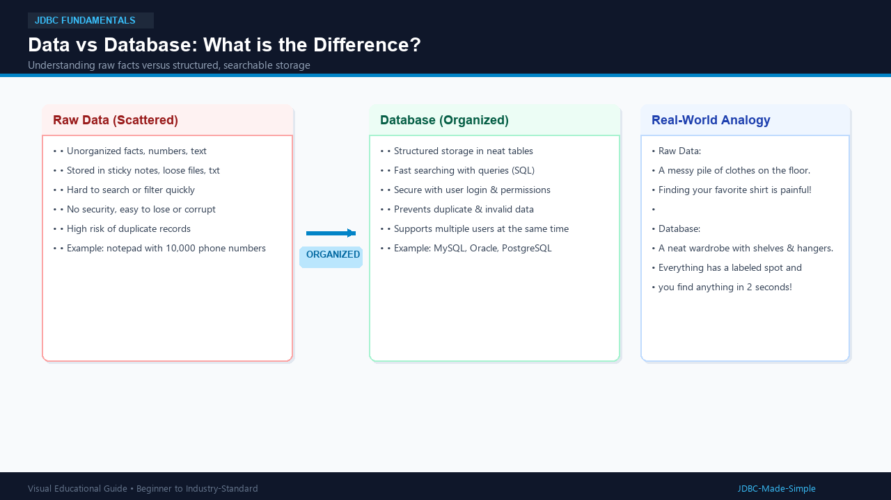
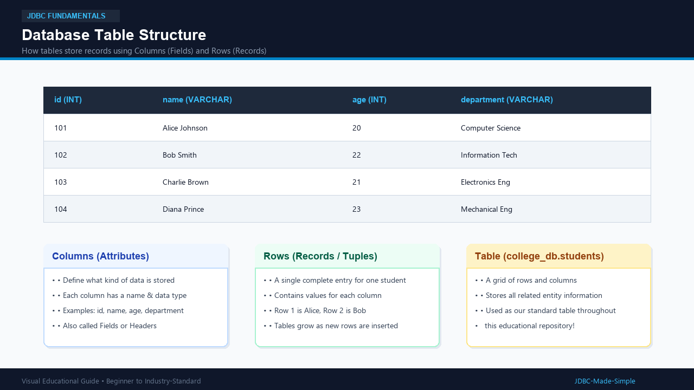
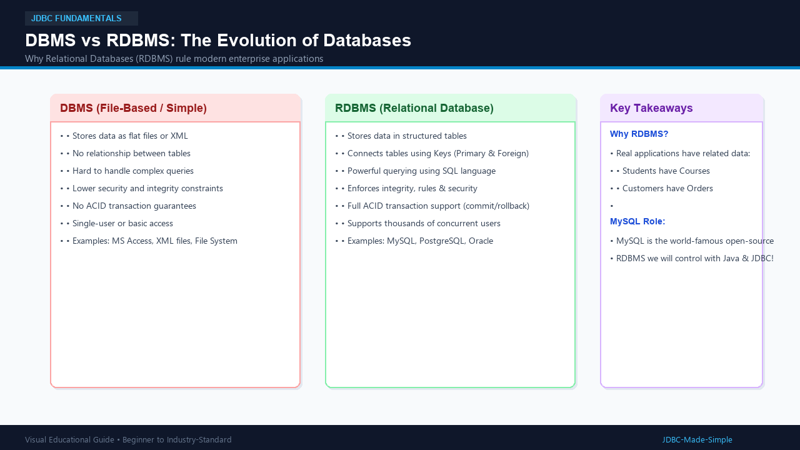

# 01. Introduction to Database

Welcome to the foundation of data storage! Before we teach Java how to talk to databases, let us understand what data and databases actually are in simple everyday words.

---

## 1. What is it?

- **Data:** Raw facts, numbers, words, or measurements. For example: 101, Alice, 20, Computer Science.
- **Database:** An organized digital container that stores data systematically so that computers can search, add, update, and delete information quickly and safely.
- **DBMS (Database Management System):** Software that helps you create and manage databases (e.g., storing simple files).
- **RDBMS (Relational Database Management System):** An advanced DBMS that organizes data into neat **tables with rows and columns** and connects related tables together.
- **MySQL:** One of the world's most popular, free, open-source RDBMS software.

---

## 2. Why do we need it?

Imagine storing 50,000 students' information in a plain text file (students.txt):
1. **Searching is painfully slow:** To find student #49,999, you have to read the whole file line by line.
2. **Data corruption:** If two people edit the text file at the same time, data gets destroyed.
3. **No security:** Anyone can open the text file and change marks or delete accounts.

A database solves all these problems:
- Instant search in milliseconds.
- Multiple users can access data at the same time without corruption.
- Strong security with passwords and user permissions.

---

## 3. Real-World Example

- **Messy Room (Raw Data):** Clothes and books tossed all over the floor. You cannot find your blue socks when you are late for college!
- **Organized Wardrobe (Database):** Labeled shelves, shoe racks, and hangers. You open the drawer and grab your socks in 2 seconds.

---

## 4. Visual Explanation

### Data vs Database

### Database Table Structure

### DBMS vs RDBMS

---

## 5. How does a Database Table Work?

A database organizes information into **Tables**. Think of a table as an Excel spreadsheet:

| id (INT) | name (VARCHAR) | age (INT) | department (VARCHAR) |
| :--- | :--- | :--- | :--- |
| **101** | Alice Johnson | 20 | Computer Science |
| **102** | Bob Smith | 22 | Information Tech |
| **103** | Charlie Brown | 21 | Electronics Eng |

- **Columns (Fields / Attributes):** The vertical headers defining what kind of data is stored (id, 
ame, ge, department).
- **Rows (Records / Tuples):** The horizontal lines containing actual student data. Row 1 belongs to Alice; Row 2 belongs to Bob.

Throughout this entire repository, we will use this exact table:
- **Database:** college_db
- **Table:** students

---

## 6. Important Points to Remember

1. Data is raw facts; a database is structured, secure storage.
2. An RDBMS stores data in tables linked by relationships.
3. MySQL is the database server we will connect to using Java JDBC.
4. Each record in a table is a **row**, and each property is a **column**.

---

## 7. Common Beginner Mistakes

- **Confusing MySQL with SQL:** SQL is the language you type (SELECT * FROM students); MySQL is the software server that runs the command.
- **Thinking databases are only for big companies:** Even small mobile phone apps use local databases to remember your login!
