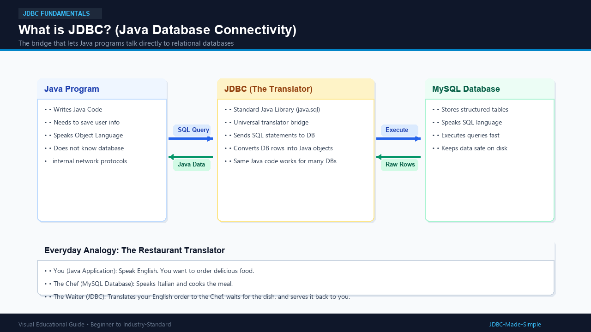
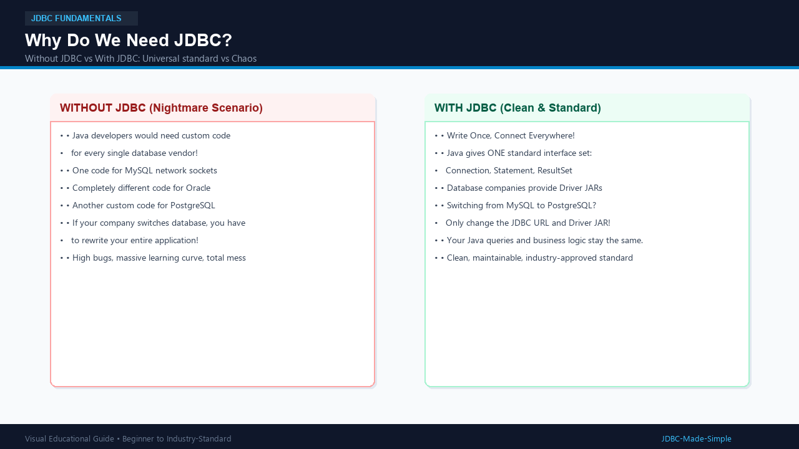
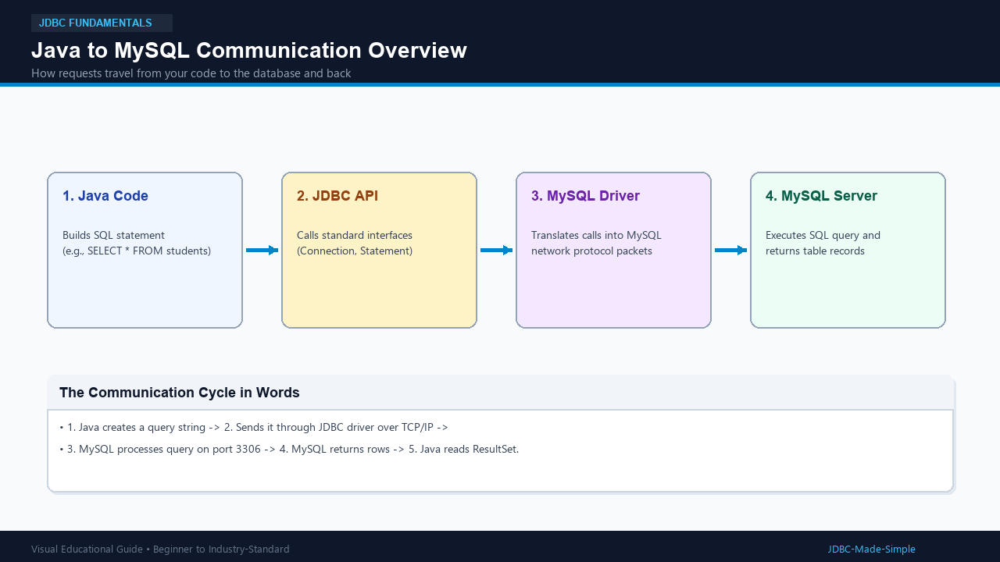

# 02. Introduction to JDBC

Now that we know what a database is, how does a Java application communicate with MySQL? This is where **JDBC** enters the picture.

---

## 1. What is it?

**JDBC** stands for **Java Database Connectivity**.

In simple words:
> **JDBC is a standard set of Java tools (interfaces and classes) that allows Java programs to talk to a relational database like MySQL.**

It comes built into Java inside the java.sql package.

---

## 2. Why do we need it?

Java and MySQL speak completely different languages:
- Java speaks **Objects** (classes, variables, methods).
- MySQL speaks **SQL** (Structured Query Language) and communicates over binary network sockets.

Without JDBC, you would have to write hundreds of lines of complex socket networking code just to send one query. Even worse, if you switched from MySQL to Oracle, you would have to rewrite your entire program from scratch!

JDBC acts as a universal adapter:
1. You write standard Java JDBC code.
2. The database vendor provides a small driver.
3. Your Java application can now talk to any database without changing its core query code!

---

## 3. Real-World Analogy: The Restaurant Waiter

- **You (Java Application):** You are hungry and want food. You speak English.
- **The Chef (MySQL Database):** Works in the kitchen. He prepares food according to recipes.
- **The Waiter (JDBC):** Takes your order from your table, delivers it to the kitchen in kitchen order language, waits for the cooked meal, and carries the food back to your table.

Without the waiter, you would have to walk into the kitchen, figure out the stoves, and argue with the cook!

---

## 4. Visual Explanation

### What is JDBC?

### Why Do We Need JDBC?

### Java to MySQL Communication Flow

---

## 5. How does it work?

Here is the high-level communication cycle:
1. **Java Program** creates a database connection request.
2. **JDBC API** passes the request to the MySQL Driver.
3. **Driver** opens a network connection to MySQL server (port 3306).
4. **Java Program** sends an SQL query (e.g., SELECT * FROM students).
5. **MySQL Server** runs the query and returns matching rows.
6. **JDBC** wraps the rows into a Java ResultSet object for your code to read.

---

## 6. Important Points to Remember

1. JDBC is part of standard Java (java.sql).
2. JDBC works with any relational database that provides a JDBC driver.
3. JDBC follows the  Write Once Run Anywhere philosophy for database code.

---

## 7. Common Beginner Mistakes

- **Thinking JDBC is a database:** JDBC is NOT a database; it is the telephone wire connecting Java to the database.
- **Forgetting the driver:** JDBC is just the interface (contract); you always need the database vendor's driver library (e.g., MySQL Connector/J) to actually communicate.
