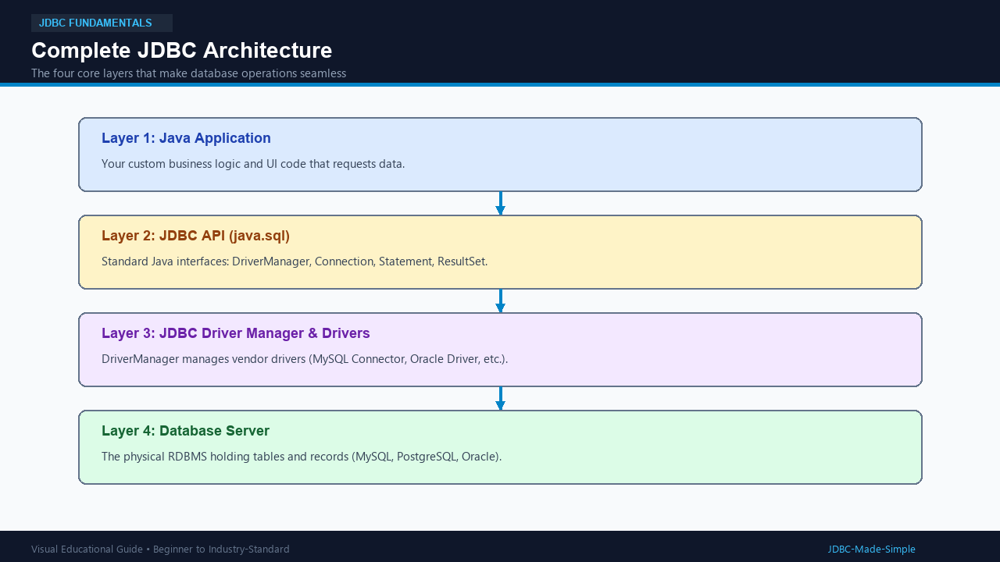
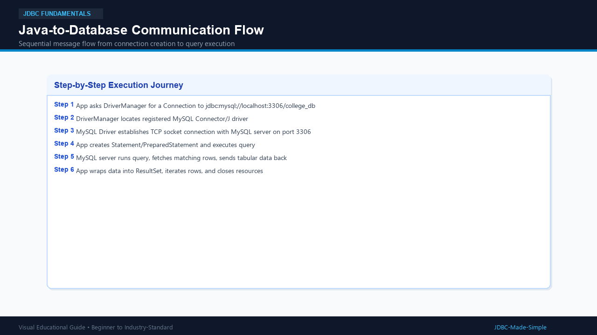

# 03. JDBC Architecture

To master JDBC, we must understand how its internal layers fit together.

---

## 1. What is it?

The JDBC Architecture is a **4-layer bridge** that links your high-level Java code to low-level database network sockets.

The four layers are:
1. **Java Application:** Your code (e.g., Main.java).
2. **JDBC API:** Standard Java interfaces located in package java.sql.
3. **JDBC Driver Manager & Driver:** The manager that selects the correct vendor driver (e.g., MySQL Connector/J).
4. **Database Server:** The physical database engine (e.g., MySQL Community Server).

---

## 2. Why do we need this layered architecture?

By separating the **API (interfaces)** from the **Driver (implementation)**:
- Sun Microsystems / Oracle creates the rules (Connection, Statement, ResultSet).
- Database companies (MySQL, Oracle, PostgreSQL, IBM) write the drivers that satisfy those rules.
- You as a developer only ever learn the standard interfaces!

---

## 3. Visual Explanation

### Complete JDBC Architecture

### Communication Flow

---

## 4. Understanding Key JDBC Components

| Component | Role in Simple Words |
| :--- | :--- |
| **DriverManager** | The factory class that manages drivers and creates database connections. |
| **Connection** | The active session / pipeline between Java and the database. |
| **Statement** | The vehicle that carries your SQL query to the database. |
| **PreparedStatement** | An improved, pre-compiled vehicle that securely accepts parameters. |
| **CallableStatement** | Used to call stored procedures defined inside the database. |
| **ResultSet** | The tabular result returned by a SELECT query. |
| **SQLException** | The exception thrown if something goes wrong during database communication. |

---

## 5. Important Points to Remember

1. JDBC architecture decouples application logic from database vendor protocols.
2. All standard JDBC interfaces live in the java.sql package.
3. DriverManager acts as the coordinator between Java code and the vendor driver.
