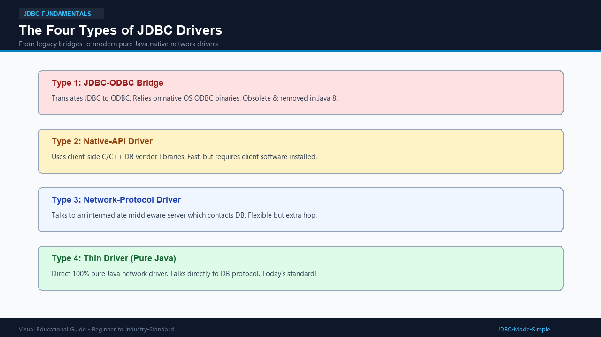
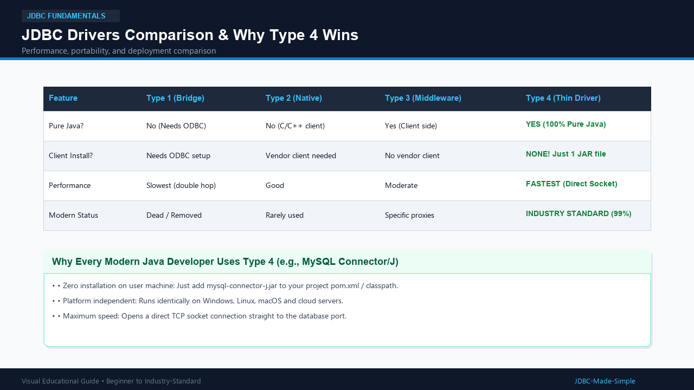

# 04. JDBC Drivers

A driver is the engine that converts standard Java method calls into the specific network commands understood by a database.

---

## 1. What is it?

A **JDBC Driver** is a software component (usually distributed as a single .jar file) that implements the standard JDBC interfaces for a specific database vendor.

Historically, Sun Microsystems defined **Four Types of JDBC Drivers**:
1. **Type 1: JDBC-ODBC Bridge Driver**
2. **Type 2: Native-API Driver (Partially Java)**
3. **Type 3: Network-Protocol Driver (Middleware)**
4. **Type 4: Thin Driver (Direct 100% Pure Java)**

---

## 2. Explanation of the Four Types

### Type 1: JDBC-ODBC Bridge Driver
- **How it worked:** Java -> JDBC -> ODBC Driver -> Native DB Library -> Database.
- **Problem:** Very slow because of multiple translations. Required ODBC configuration on every single user machine.
- **Status:** **Obsolete and removed in Java 8.**

### Type 2: Native-API Driver
- **How it worked:** Java -> JDBC Driver -> Vendor C/C++ Client Library -> Database.
- **Problem:** Required vendor client software (like Oracle Client) installed on every client machine. Not platform-independent.
- **Status:** Rarely used today.

### Type 3: Network-Protocol Driver (Middleware)
- **How it worked:** Java -> JDBC Driver -> Middleware Application Server -> Database.
- **Problem:** Needed an extra server in between, adding latency and maintenance overhead.
- **Status:** Used only in specialized enterprise proxy environments.

### Type 4: Thin Driver (Pure Java Driver)
- **How it works:** Java -> Type 4 Driver -> Direct TCP/IP Socket -> Database.
- **Why it wins:** Written 100% in Java. Connects directly to database network protocol. No software installation needed on the client machine! Just include the JAR file in your project.
- **Status:** **The universal industry standard used today (e.g., MySQL Connector/J).**

---

## 3. Visual Explanation

### The Four Driver Types

### Driver Comparison Table

---

## 4. Comparison Table

| Driver Type | Pure Java? | Client Installation Required? | Performance | Current Industry Status |
| :--- | :--- | :--- | :--- | :--- |
| **Type 1** | No | Yes (ODBC setup) | Slowest | Obsolete (Removed in Java 8) |
| **Type 2** | No (Uses C/C++) | Yes (Vendor Client) | Medium | Rare |
| **Type 3** | Yes (Client side) | No vendor client | Moderate | Specialized middleware |
| **Type 4** | **Yes (100% Pure Java)** | **None (Just 1 JAR file)** | **Fastest** | **Modern Standard (99%)** |

---

## 5. Why Type 4 is Used Everywhere Today

1. **Zero Client Installation:** You do not have to install MySQL on the user's PC. If your Java app runs on a user's laptop, it only needs the JAR file to connect to a cloud database!
2. **Platform Independent:** Works seamlessly on Windows, macOS, Linux, Docker, and Cloud Kubernetes clusters.
3. **Maximum Speed:** Direct network communication without intermediate bridges.
