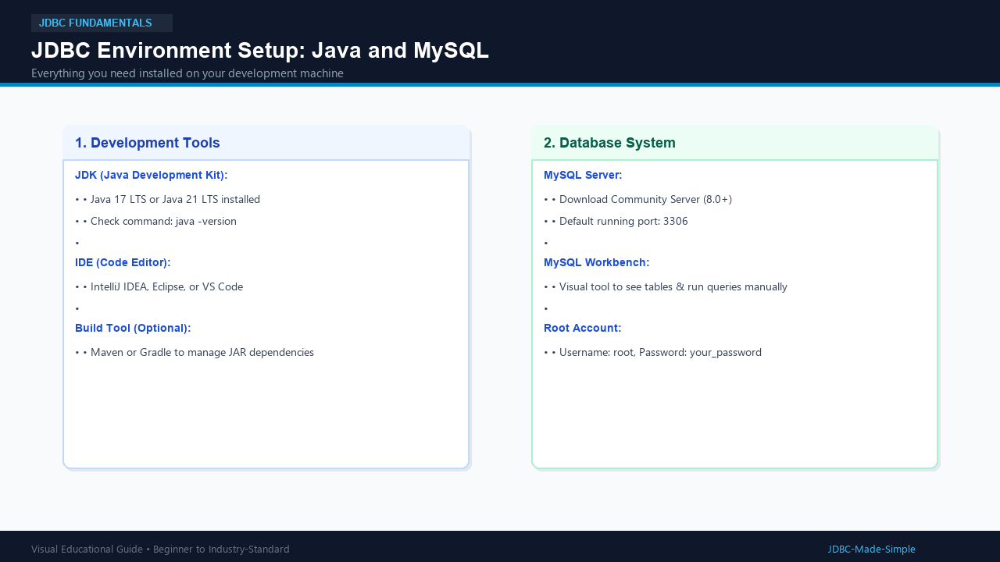
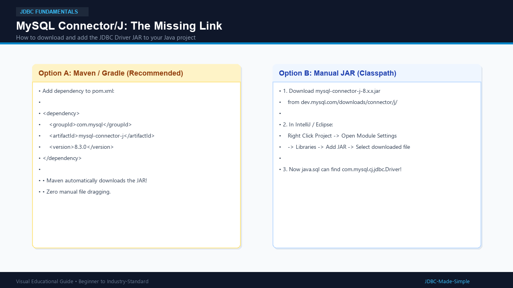

# 05. JDBC Environment Setup

Let us set up everything needed to run your first real JDBC program.

---

## 1. What do we need?

To connect Java to MySQL, you need three software components:
1. **Java Development Kit (JDK 17 or higher):** To compile and run Java programs.
2. **MySQL Server (8.0 or higher):** The database engine that holds our data.
3. **MySQL Connector/J:** The Type 4 JDBC driver JAR file that bridges Java and MySQL.

---

## 2. Visual Explanation

### Java and MySQL Setup Overview

### Adding MySQL Connector/J to your Project

---

## 3. Step-by-Step Setup Guide

### Step 1: Install MySQL Server and Workbench
1. Download MySQL Community Server from dev.mysql.com.
2. During installation, set root password (e.g., 
oot123). Remember this password!
3. Start the MySQL service on port 3306.

### Step 2: Create the Database and Table
Open MySQL Workbench or your terminal and execute:

`sql
CREATE DATABASE college_db;

USE college_db;

CREATE TABLE students (
    id INT PRIMARY KEY,
    name VARCHAR(50) NOT NULL,
    age INT,
    department VARCHAR(50)
);

-- Insert sample records
INSERT INTO students (id, name, age, department) VALUES
(101, 'Alice Johnson', 20, 'Computer Science'),
(102, 'Bob Smith', 22, 'Information Tech');
`

### Step 3: Add MySQL Connector/J to your Java Project

If using **Maven**, add this to your pom.xml:
`xml
<dependency>
    <groupId>com.mysql</groupId>
    <artifactId>mysql-connector-j</artifactId>
    <version>8.3.0</version>
</dependency>
`

If using a plain Java project without Maven:
1. Download mysql-connector-j-8.3.0.jar.
2. Add it to your project classpath / libraries.

---

## 4. Your First Test Program

Let us verify that Java can find the MySQL Driver class.

### Java Code: DriverTest.java

`java
package com.example.jdbc;

public class DriverTest {
    public static void main(String[] args) {
        System.out.println(Checking MySQL JDBC Driver availability...);

        try {
            // Check if the MySQL driver class is present in classpath
            Class.forName(com.mysql.cj.jdbc.Driver);
            System.out.println(SUCCESS: MySQL Connector/J driver found on classpath!);
        } catch (ClassNotFoundException e) {
            System.err.println(ERROR: MySQL Driver not found! Please add mysql-connector-j.jar to classpath.);
            e.printStackTrace();
        }
    }
}
`

---

## 5. Expected Output

When the driver JAR is present in classpath:
`	ext
Checking MySQL JDBC Driver availability...
SUCCESS: MySQL Connector/J driver found on classpath!
`

---

## 6. Common Beginner Mistakes

- **ClassNotFoundException: com.mysql.cj.jdbc.Driver:** This means your project does not have the MySQL Connector/J JAR in its libraries.
- **Using old driver class name:** Old tutorials use com.mysql.jdbc.Driver. For modern MySQL 8.0+, always use com.mysql.cj.jdbc.Driver.
