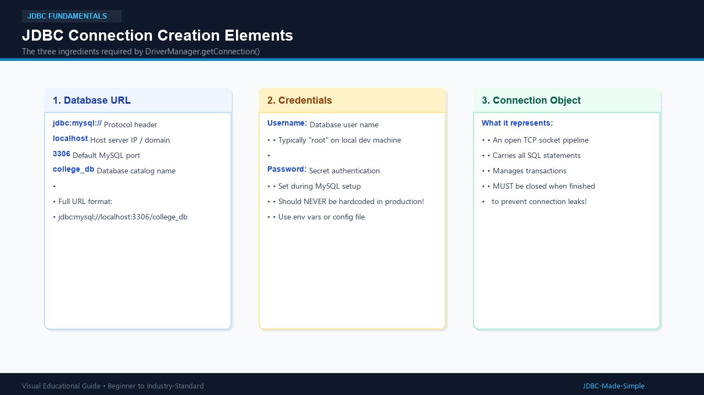
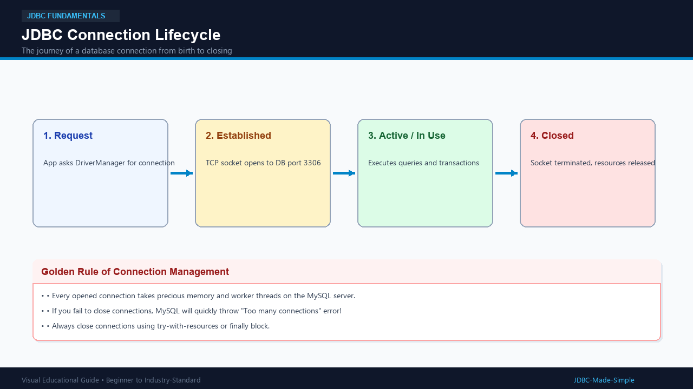

# 06. JDBC Connection

Once the MySQL driver is on your classpath, the very first real action you take is creating a **Connection**.

---

## 1. What is it?

A **Connection** in JDBC represents an active, physical communication session (a TCP network socket) between your Java program and the MySQL database server.

You obtain a connection using the `DriverManager` class:
```java
Connection conn = DriverManager.getConnection(url, user, password);
```

---

## 2. Why do we need it?

Think of your Java program and MySQL server as two offices in different cities.
- You cannot send documents (SQL queries) into thin air.
- You must first lay down a secure telephone wire (Connection).
- All queries, updates, and transaction commits travel over this single wire!

---

## 3. Real-World Example

Opening a database connection is like making a phone call:
1. You dial the phone number (JDBC URL: `localhost:3306/college_db`).
2. You identify who you are (Username: `root`, Password: `secret`).
3. The other person answers: **Connection established!**
4. You talk and share information (SQL queries).
5. When finished, you **hang up the phone** (close the connection).

---

## 4. Visual Explanation

### Connection Creation Elements


### Connection Lifecycle


---

## 5. How does it work?

A JDBC URL follows this standard format:
`jdbc:mysql://[host]:[port]/[database_name]`

- `jdbc:` -> Tells Java to use the JDBC protocol.
- `mysql:` -> Identifies MySQL as the database vendor.
- `localhost` -> The machine where MySQL runs (`127.0.0.1`).
- `3306` -> Default port for MySQL server.
- `college_db` -> The target database.

---

## 6. Java Code Example: `ConnectionDemo.java`

```java
package com.example.jdbc;

import java.sql.Connection;
import java.sql.DriverManager;
import java.sql.SQLException;

public class ConnectionDemo {
    public static void main(String[] args) {
        String url = "jdbc:mysql://localhost:3306/college_db";
        // Retrieve credentials safely from environment variables (or fall back to dev values)
        String user = System.getenv("DB_USER") != null ? System.getenv("DB_USER") : "root";
        String password = System.getenv("DB_PASSWORD") != null ? System.getenv("DB_PASSWORD") : "root123";

        System.out.println("Attempting connection to " + url + "...");

        try (Connection conn = DriverManager.getConnection(url, user, password)) {
            if (conn != null && !conn.isClosed()) {
                System.out.println("SUCCESS: Connected to MySQL database college_db successfully!");
                System.out.println("Connection class: " + conn.getClass().getName());
            }
        } catch (SQLException e) {
            System.err.println("Database connection failed!");
            System.err.println("Error code: " + e.getErrorCode());
            System.err.println("SQL State: " + e.getSQLState());
            e.printStackTrace();
        }
    }
}
```

---

## 7. Code Explanation

- `DriverManager.getConnection(...)`: Coordinates with the MySQL driver to authenticate and open the network socket.
- `try (Connection conn = ...)`: Uses Java's try-with-resources to guarantee the connection is closed immediately when the block finishes.
- `conn.isClosed()`: Returns `false` while the connection is healthy and active.

---

## 8. Expected Output

```text
Attempting connection to jdbc:mysql://localhost:3306/college_db...
SUCCESS: Connected to MySQL database college_db successfully!
Connection class: com.mysql.cj.jdbc.ConnectionImpl
```

---

## 9. Important Points

1. Creating a connection is a heavy operation (TCP handshake + authentication).
2. Always ensure connections are closed to prevent memory and socket leaks on MySQL.
3. In modern production environments, connection pools (like HikariCP) are used instead of opening raw connections repeatedly.

---

## 10. Common Mistakes

- **Incorrect port or typo in URL:** Writing `33060` instead of `3306` results in `CommunicationsException`.
- **Database does not exist:** If `college_db` has not been created yet in MySQL, you will get `Unknown database 'college_db'`.
