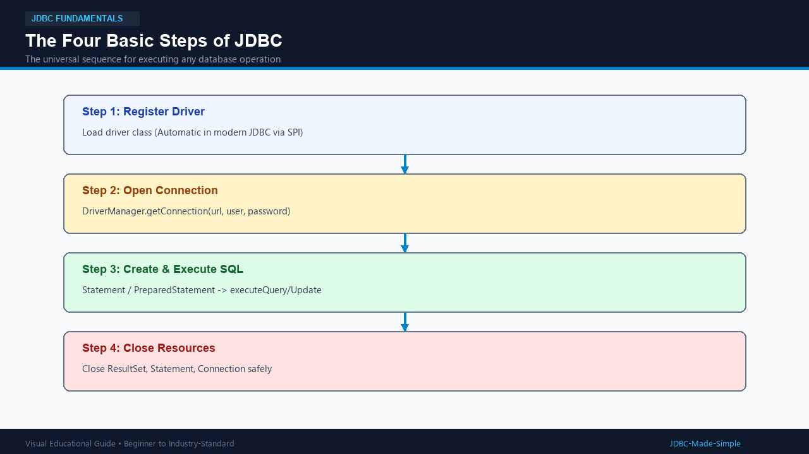
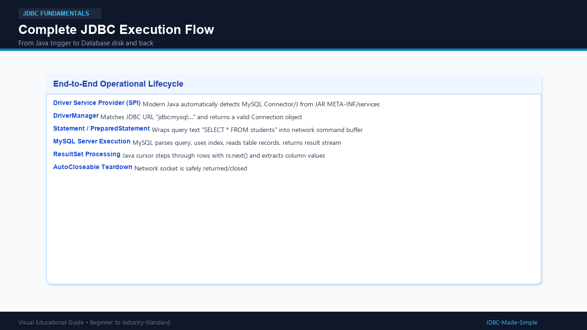

# 07. The Four Basic Steps of JDBC

Every JDBC program follows the exact same 4-step rhythm. Master these 4 steps and you master the heart of JDBC!

---

## 1. What are the Four Steps?

1. **Step 1: Load/Register the Driver**
2. **Step 2: Establish the Connection**
3. **Step 3: Create a Statement and Execute SQL**
4. **Step 4: Process the Results and Close Resources**

---

## 2. Deep Dive into Each Step

### Step 1: Load and Register the Driver
- **Traditional Approach:**
  ```java
  Class.forName("com.mysql.cj.jdbc.Driver");
  ```
  This dynamically loads the bytecode of the MySQL driver class into JVM memory, which executes its static initializer to register with `DriverManager`.
- **Modern Approach (JDBC 4.0+ / Java 6+):**
  **`Class.forName()` is completely optional!**
  Modern JDBC drivers include a file inside `META-INF/services/java.sql.Driver`. The JVM's `ServiceLoader` automatically detects and registers the driver as soon as your program calls `DriverManager.getConnection()`.

### Step 2: Establish the Connection
```java
Connection conn = DriverManager.getConnection(url, user, password);
```

### Step 3: Create Statement and Execute SQL
```java
Statement stmt = conn.createStatement();
ResultSet rs = stmt.executeQuery("SELECT id, name FROM students");
```

### Step 4: Process Results and Close Resources
```java
while (rs.next()) {
    System.out.println(rs.getInt("id") + ": " + rs.getString("name"));
}
rs.close();
stmt.close();
conn.close();
```

---

## 3. Visual Explanation

### The Four Steps


### Complete JDBC Execution Flow


---

## 4. Java Code: `FourStepsDemo.java`

```java
package com.example.jdbc;

import java.sql.Connection;
import java.sql.DriverManager;
import java.sql.ResultSet;
import java.sql.Statement;
import java.sql.SQLException;

public class FourStepsDemo {
    public static void main(String[] args) {
        String url = "jdbc:mysql://localhost:3306/college_db";
        String user = System.getenv("DB_USER") != null ? System.getenv("DB_USER") : "root";
        String password = System.getenv("DB_PASSWORD") != null ? System.getenv("DB_PASSWORD") : "root123";

        // Step 1: In modern JDBC, driver is loaded automatically via Service Provider Mechanism!
        System.out.println("Step 1: Driver automatically detected via ServiceLoader.");

        // Step 2, 3, 4 wrapped cleanly in try-with-resources
        try (Connection conn = DriverManager.getConnection(url, user, password); // Step 2
             Statement stmt = conn.createStatement();                             // Step 3 (Create)
             ResultSet rs = stmt.executeQuery("SELECT id, name, age, department FROM students")) { // Step 3 (Execute)

            System.out.println("Step 2: Connected successfully!");
            System.out.println("Step 3: Query executed.");
            System.out.println("Step 4: Processing records:");

            // Step 4 (Process)
            while (rs.next()) {
                int id = rs.getInt("id");
                String name = rs.getString("name");
                int age = rs.getInt("age");
                String dept = rs.getString("department");
                System.out.println(" -> Student #" + id + " | " + name + " | Age: " + age + " | Dept: " + dept);
            }
            // Step 4 (Close): Handled automatically when exiting try block!
        } catch (SQLException e) {
            e.printStackTrace();
        }
    }
}
```

---

## 5. Expected Output

```text
Step 1: Driver automatically detected via ServiceLoader.
Step 2: Connected successfully!
Step 3: Query executed.
Step 4: Processing records:
 -> Student #101 | Alice Johnson | Age: 20 | Dept: Computer Science
 -> Student #102 | Bob Smith | Age: 22 | Dept: Information Tech
```

---

## 6. Important Points

1. Know both traditional (`Class.forName`) and modern (automatic SPI) driver loading for interviews.
2. Resource closing must always occur in reverse order of creation: `ResultSet` -> `Statement` -> `Connection`.
