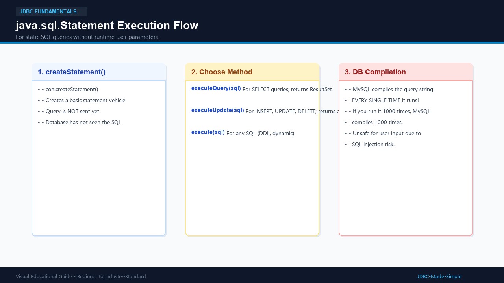

# 08. Statement

The `java.sql.Statement` interface represents the simplest way to execute static SQL statements against a database.

---

## 1. What is it?

A `Statement` is a basic vehicle that transports a raw SQL query string to the database and brings back results.

You create a statement using:
```java
Statement stmt = conn.createStatement();
```

---

## 2. Key Methods of Statement

| Method | What It Does | Return Type | Best For |
| :--- | :--- | :--- | :--- |
| **`executeQuery(sql)`** | Runs a read-only query | `ResultSet` | `SELECT` |
| **`executeUpdate(sql)`** | Modifies table data/schema | `int` (affected row count) | `INSERT`, `UPDATE`, `DELETE` |
| **`execute(sql)`** | Runs any arbitrary SQL | `boolean` (`true` if ResultSet, `false` if count) | Dynamic or DDL commands (`CREATE`, `DROP`) |

---

## 3. Visual Explanation

### Statement Execution Flow


---

## 4. Java Code: `StatementCRUDDemo.java`

```java
package com.example.jdbc;

import java.sql.Connection;
import java.sql.DriverManager;
import java.sql.ResultSet;
import java.sql.Statement;
import java.sql.SQLException;

public class StatementCRUDDemo {
    public static void main(String[] args) {
        String url = "jdbc:mysql://localhost:3306/college_db";
        String user = System.getenv("DB_USER") != null ? System.getenv("DB_USER") : "root";
        String password = System.getenv("DB_PASSWORD") != null ? System.getenv("DB_PASSWORD") : "root123";

        try (Connection conn = DriverManager.getConnection(url, user, password);
             Statement stmt = conn.createStatement()) {

            // 1. INSERT using executeUpdate()
            String insertSql = "INSERT INTO students (id, name, age, department) VALUES (103, 'Charlie Brown', 21, 'Mechanical')";
            int rowsInserted = stmt.executeUpdate(insertSql);
            System.out.println("Rows inserted: " + rowsInserted);

            // 2. UPDATE using executeUpdate()
            String updateSql = "UPDATE students SET department = 'Mechanical Eng' WHERE id = 103";
            int rowsUpdated = stmt.executeUpdate(updateSql);
            System.out.println("Rows updated: " + rowsUpdated);

            // 3. SELECT using executeQuery()
            String selectSql = "SELECT id, name, age, department FROM students WHERE id = 103";
            try (ResultSet rs = stmt.executeQuery(selectSql)) {
                if (rs.next()) {
                    System.out.println("Fetched: " + rs.getString("name") + " (" + rs.getString("department") + ")");
                }
            }

            // 4. DELETE using executeUpdate()
            String deleteSql = "DELETE FROM students WHERE id = 103";
            int rowsDeleted = stmt.executeUpdate(deleteSql);
            System.out.println("Rows deleted: " + rowsDeleted);

        } catch (SQLException e) {
            e.printStackTrace();
        }
    }
}
```

---

## 5. When to use (and NOT use) Statement

- **Use Statement only for:**
  Static SQL statements that do not accept runtime variables from users (e.g., executing one-time database setup scripts: `CREATE TABLE`, `DROP TABLE`).
- **Do NOT use Statement for:**
  Any query with runtime user variables. String concatenation creates severe **SQL Injection** security vulnerabilities! Use `PreparedStatement` instead.
