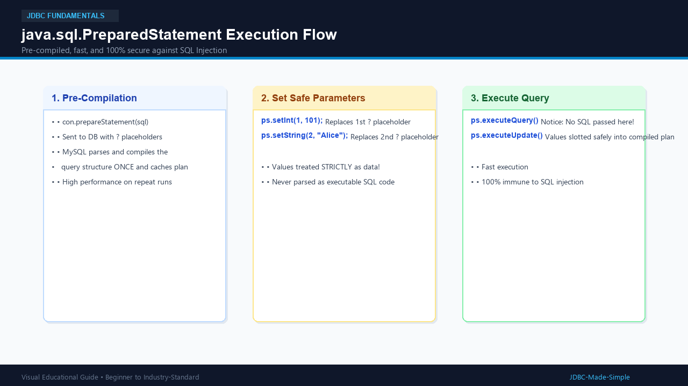
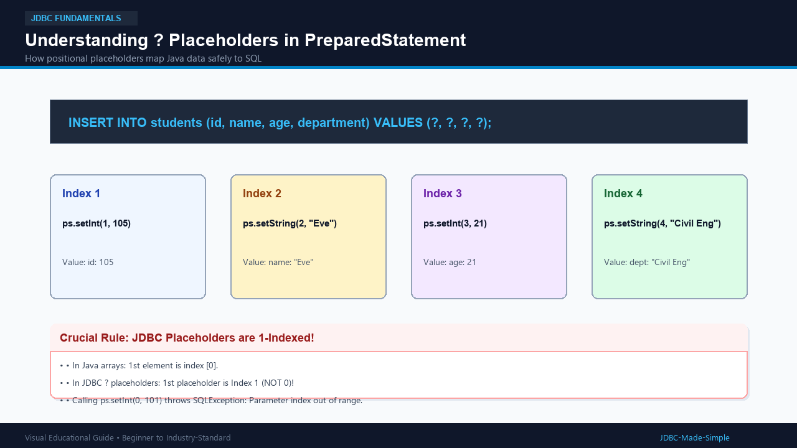
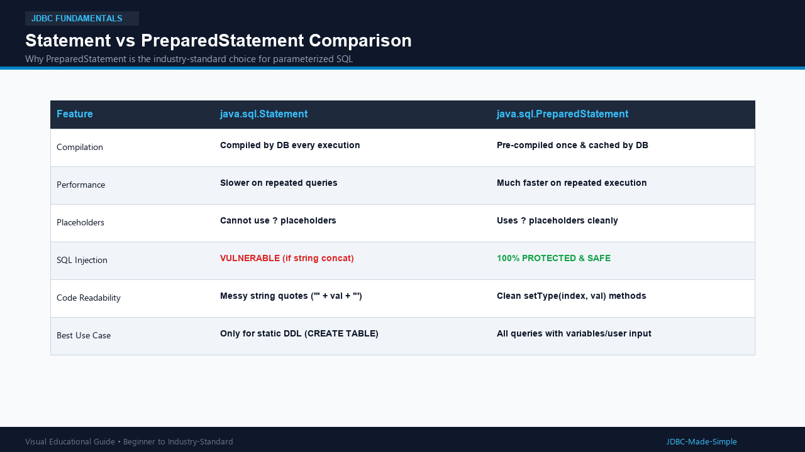

# 09. PreparedStatement

The `java.sql.PreparedStatement` interface is the cornerstone of modern, professional JDBC coding.

---

## 1. What is it?

A **PreparedStatement** is a pre-compiled SQL statement. Instead of embedding user values directly into the SQL string with quotes, you define **parameter placeholders** using question marks (`?`).

```java
String sql = "SELECT * FROM students WHERE department = ? AND age >= ?";
PreparedStatement ps = conn.prepareStatement(sql);
ps.setString(1, "Computer Science");
ps.setInt(2, 20);
ResultSet rs = ps.executeQuery();
```

---

## 2. Why do we need it?

1. **Security (SQL Injection Immunity):** The database compiles the SQL skeleton first. Any user input provided later is treated strictly as literal data, never as executable code.
2. **High Performance:** When executed repeatedly with different parameters, the database reuses the already compiled query execution plan.
3. **Clean Code:** Eliminates messy string concatenation, escaping, and single-quote errors.

---

## 3. Visual Explanation

### PreparedStatement Flow


### Understanding ? Placeholders


### Statement vs PreparedStatement Comparison


---

## 4. Java Code: `PreparedStatementDemo.java`

```java
package com.example.jdbc;

import java.sql.Connection;
import java.sql.DriverManager;
import java.sql.PreparedStatement;
import java.sql.ResultSet;
import java.sql.SQLException;

public class PreparedStatementDemo {
    public static void main(String[] args) {
        String url = "jdbc:mysql://localhost:3306/college_db";
        String user = System.getenv("DB_USER") != null ? System.getenv("DB_USER") : "root";
        String password = System.getenv("DB_PASSWORD") != null ? System.getenv("DB_PASSWORD") : "root123";

        String insertSql = "INSERT INTO students (id, name, age, department) VALUES (?, ?, ?, ?)";
        String selectSql = "SELECT id, name, age, department FROM students WHERE department = ?";

        try (Connection conn = DriverManager.getConnection(url, user, password)) {

            // 1. Safe Parameterized Insertion
            try (PreparedStatement insertStmt = conn.prepareStatement(insertSql)) {
                insertStmt.setInt(1, 104);
                insertStmt.setString(2, "Diana Prince");
                insertStmt.setInt(3, 23);
                insertStmt.setString(4, "Civil Eng");

                int rows = insertStmt.executeUpdate();
                System.out.println("Safe insert completed! Rows: " + rows);
            }

            // 2. Safe Parameterized Query
            try (PreparedStatement selectStmt = conn.prepareStatement(selectSql)) {
                selectStmt.setString(1, "Computer Science");

                try (ResultSet rs = selectStmt.executeQuery()) {
                    System.out.println("--- Students in Computer Science ---");
                    while (rs.next()) {
                        System.out.println(rs.getInt("id") + ": " + rs.getString("name"));
                    }
                }
            }

        } catch (SQLException e) {
            e.printStackTrace();
        }
    }
}
```

---

## 5. Important Rules for Placeholders

- **1-based Indexing:** The first `?` placeholder is index `1`, not index `0`!
- **Data type matching:** Use `setInt()` for integers, `setString()` for strings, `setDouble()` for floating points.
- **Notice `executeQuery()` without args:** Call `ps.executeQuery()` (with NO arguments). Calling `ps.executeQuery(sql)` accidentally reverts back to plain Statement behavior!
