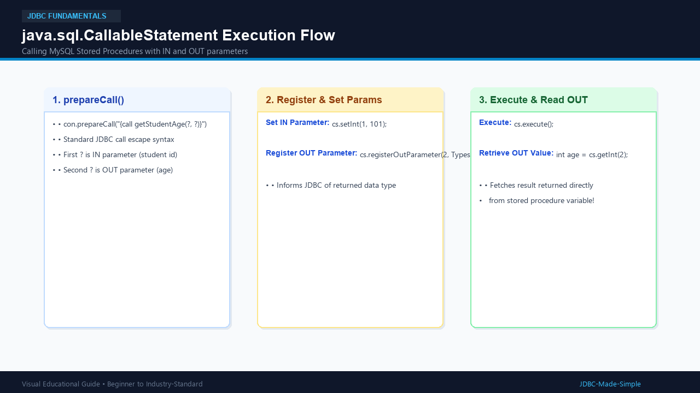
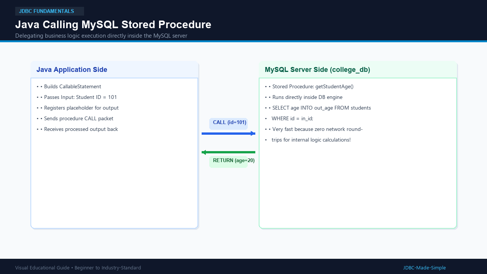

# 10. CallableStatement

The `java.sql.CallableStatement` interface allows Java applications to execute **Stored Procedures** and functions defined inside the MySQL database.

---

## 1. What is it?

A **Stored Procedure** is a pre-compiled set of SQL statements stored directly inside the MySQL server.
`CallableStatement` is the JDBC interface used to invoke these procedures:

```java
CallableStatement cs = conn.prepareCall("{call getStudentAge(?, ?)}");
```

---

## 2. Parameter Types in Procedures

1. **`IN` Parameter:** Input passed from Java into the database procedure.
2. **`OUT` Parameter:** Output calculated by the procedure and returned to Java.
3. **`INOUT` Parameter:** Input passed from Java, modified by the procedure, and read back.

---

## 3. Visual Explanation

### CallableStatement Execution Flow


### Java to Stored Procedure Communication


---

## 4. MySQL Stored Procedure SQL Script

Save this script in `SQL/getStudentAge.sql` and run it in MySQL:

```sql
USE college_db;

DELIMITER //

CREATE PROCEDURE getStudentAge(
    IN in_student_id INT,
    OUT out_student_age INT
)
BEGIN
    SELECT age INTO out_student_age
    FROM students
    WHERE id = in_student_id;
END //

DELIMITER ;
```

---

## 5. Java Code: `CallableStatementDemo.java`

```java
package com.example.jdbc;

import java.sql.CallableStatement;
import java.sql.Connection;
import java.sql.DriverManager;
import java.sql.SQLException;
import java.sql.Types;

public class CallableStatementDemo {
    public static void main(String[] args) {
        String url = "jdbc:mysql://localhost:3306/college_db";
        String user = System.getenv("DB_USER") != null ? System.getenv("DB_USER") : "root";
        String password = System.getenv("DB_PASSWORD") != null ? System.getenv("DB_PASSWORD") : "root123";

        String procedureCall = "{call getStudentAge(?, ?)}";

        try (Connection conn = DriverManager.getConnection(url, user, password);
             CallableStatement cs = conn.prepareCall(procedureCall)) {

            // Set IN parameter (1st ?)
            cs.setInt(1, 101);

            // Register OUT parameter (2nd ?) with its SQL data type
            cs.registerOutParameter(2, Types.INTEGER);

            // Execute the procedure on MySQL
            cs.execute();

            // Retrieve the returned value from OUT parameter
            int studentAge = cs.getInt(2);
            System.out.println("Age returned from MySQL Stored Procedure: " + studentAge);

        } catch (SQLException e) {
            e.printStackTrace();
        }
    }
}
```

---

## 6. Important Points

1. Always use `registerOutParameter()` for all `OUT` and `INOUT` parameters before calling `cs.execute()`.
2. Stored procedures reduce network traffic because complex multi-step database operations run directly on the database server.
