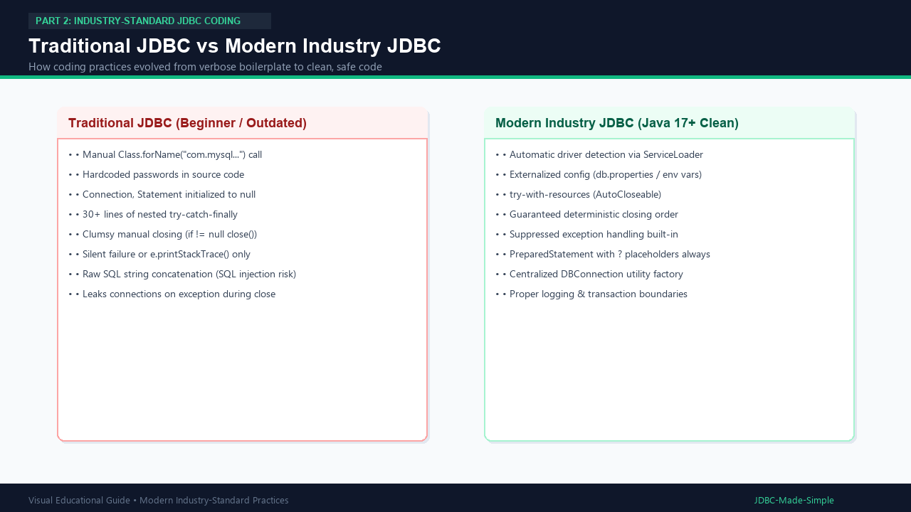

# 11. Traditional JDBC vs Modern JDBC

Welcome to **Part 2: Industry-Standard JDBC Coding**. Here we bridge the gap between classroom theory and production engineering.

---

## 1. What is the Difference?

- **Traditional JDBC (How Beginners Code):**
  - Manually calls `Class.forName("com.mysql.cj.jdbc.Driver")`.
  - Hardcodes passwords and URLs inside business logic classes.
  - Initializes `Connection`, `Statement`, `ResultSet` to `null`.
  - Uses 30+ lines of nested `try-catch-finally` with manual `close()` checks.
  - Concatenates user input into SQL strings (SQL injection vulnerability).

- **Modern Industry-Standard JDBC:**
  - Relies on Java's automatic driver registration via `ServiceLoader`.
  - Stores credentials securely in `db.properties` or environment variables.
  - Uses **`try-with-resources`** (`AutoCloseable`) for 100% leak-proof cleanup.
  - Always uses `PreparedStatement` with `?` parameter placeholders.
  - Centralizes connection creation into a clean `DBConnection` utility.

---

## 2. Visual Explanation

### Traditional vs Modern JDBC Comparison


---

## 3. Side-by-Side Comparison

### Traditional Approach (Boilerplate & Dangerous)
```java
Connection conn = null;
Statement stmt = null;
ResultSet rs = null;
try {
    Class.forName("com.mysql.cj.jdbc.Driver");
    conn = DriverManager.getConnection("jdbc:mysql://localhost:3306/college_db", "root", "secret");
    stmt = conn.createStatement();
    rs = stmt.executeQuery("SELECT * FROM students WHERE name = '" + studentName + "'");
    while (rs.next()) {
        System.out.println(rs.getString("name"));
    }
} catch (Exception e) {
    e.printStackTrace();
} finally {
    // 15 lines of clumsy null checks just to close!
    if (rs != null) try { rs.close(); } catch (SQLException e) {}
    if (stmt != null) try { stmt.close(); } catch (SQLException e) {}
    if (conn != null) try { conn.close(); } catch (SQLException e) {}
}
```

### Modern Industry Approach (Concise, Clean & Safe)
```java
String sql = "SELECT id, name, department FROM students WHERE name = ?";
try (Connection conn = DBConnection.getConnection();
     PreparedStatement ps = conn.prepareStatement(sql)) {

    ps.setString(1, studentName);
    try (ResultSet rs = ps.executeQuery()) {
        while (rs.next()) {
            System.out.println(rs.getInt("id") + ": " + rs.getString("name"));
        }
    }
} catch (SQLException e) {
    logger.log(Level.SEVERE, "Database error", e);
}
```

---

## 4. Advantages of Modern Coding

1. **Zero Resource Leaks:** Resources are guaranteed to close even if an unhandled runtime exception strikes.
2. **Readability:** 8 lines instead of 40 lines.
3. **Security:** SQL Injection is impossible when parameterized.
