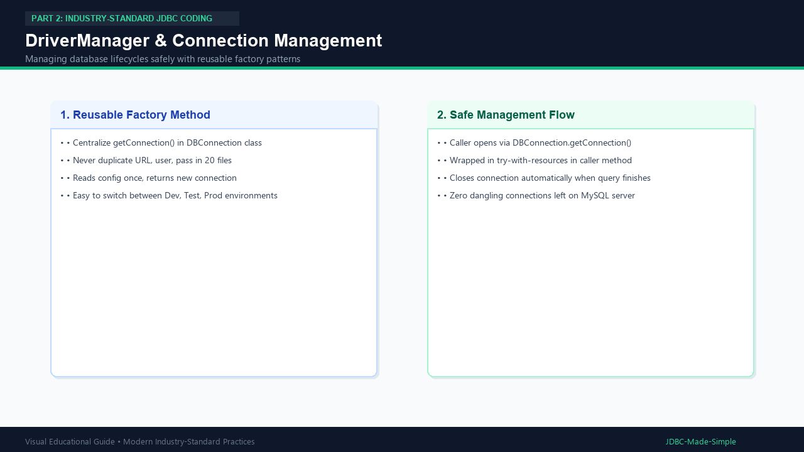

# 12. DriverManager and Connection Management

Managing connections effectively is the foundation of high-performance database applications.

---

## 1. What is Connection Management?

Instead of scattered `DriverManager.getConnection()` calls across multiple classes with hardcoded strings, connection management centralizes configuration and connection lifecycle.

---

## 2. Visual Explanation

### Connection Management Flow

---

## 3. Best Practices in Modern Connection Management

1. **Centralize creation:** Use a single factory method `DBConnection.getConnection()`.
2. **Never hardcode secrets:** Read credentials from external `db.properties` or system environment variables.
3. **Keep connection lifetime short:** Open right before query execution, close immediately after reading results.
4. **Use connection pooling in production:** In high-traffic apps, opening and closing physical TCP sockets every millisecond is too slow. A connection pool (such as HikariCP) keeps a pool of open connections ready for instant reuse.
