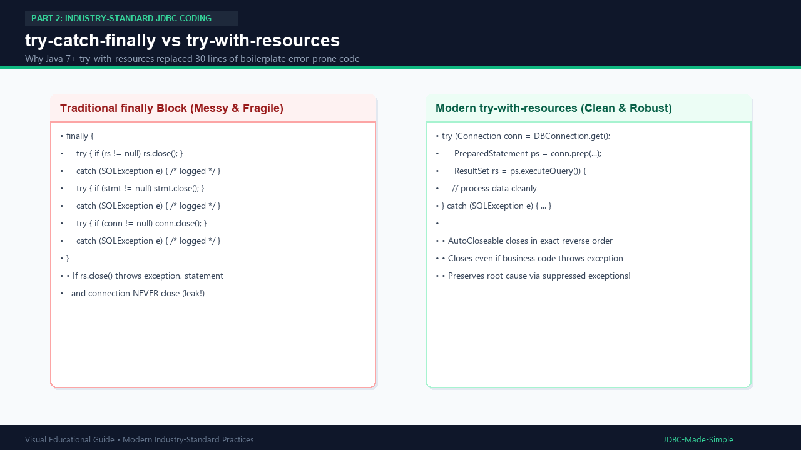

# 13. try-catch-finally vs try-with-resources

Introduced in Java 7, **try-with-resources** completely revolutionized JDBC programming.

---

## 1. How try-with-resources works

Any class implementing `java.lang.AutoCloseable` can be placed inside the parentheses of a `try` block:

```java
try (Connection conn = DBConnection.getConnection();
     PreparedStatement ps = conn.prepareStatement(sql);
     ResultSet rs = ps.executeQuery()) {
    // Read data safely
} // rs, ps, and conn close AUTOMATICALLY right here in reverse order!
```

---

## 2. Visual Explanation

### try-catch-finally vs try-with-resources


---

## 3. What happens internally when the try block finishes?

1. The JVM invokes `close()` on `ResultSet` first.
2. Next, it invokes `close()` on `PreparedStatement`.
3. Finally, it invokes `close()` on `Connection`.
4. If an exception occurs during query execution AND an exception also occurs while closing, Java attaches the closing exception as a **suppressed exception** (`e.getSuppressed()`). The original root cause is never lost!
