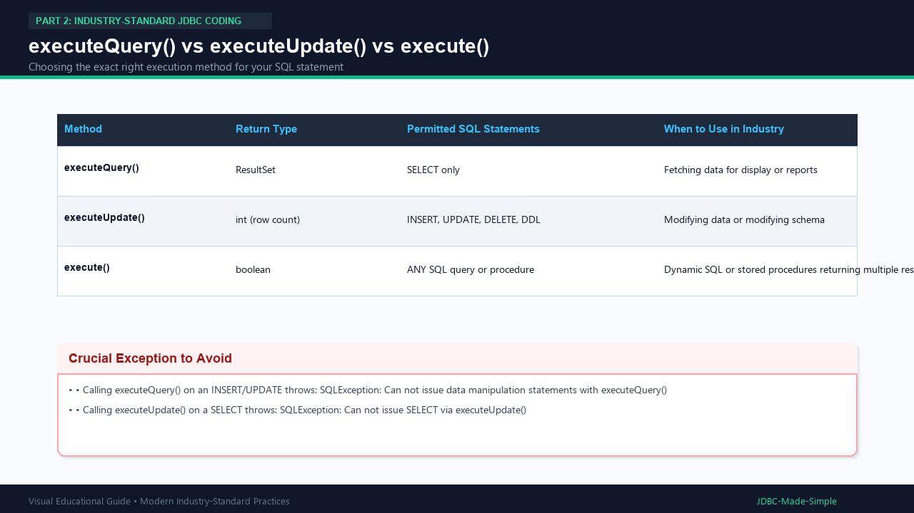

# 14. executeQuery() vs executeUpdate() vs execute()

Understanding the exact return type and purpose of the three statement execution methods is critical for bug-free code.

---

## 1. Summary Comparison

| Method | What SQL is Allowed? | Return Value | Typical Usage |
| :--- | :--- | :--- | :--- |
| **`executeQuery()`** | `SELECT` only | `ResultSet` | Fetching rows for display |
| **`executeUpdate()`** | `INSERT`, `UPDATE`, `DELETE`, `DDL` | `int` (affected row count) | Modifying rows or schema |
| **`execute()`** | Any valid SQL | `boolean` (`true` if ResultSet, `false` if row count) | Dynamic queries or stored procedures |

---

## 2. Visual Explanation

### Comparison Diagram

---

## 3. Important Rules

- Never call `executeQuery()` on an `INSERT` statement! MySQL driver will throw:
  `SQLException: Can not issue data manipulation statements with executeQuery()`
- Never call `executeUpdate()` on a `SELECT` statement! MySQL driver will throw:
  `SQLException: Can not issue SELECT via executeUpdate()`
