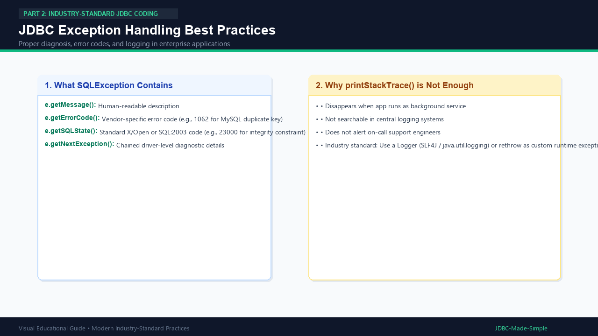

# 15. JDBC Exception Handling

In production environments, a silent failure or raw `e.printStackTrace()` can crash systems or leak sensitive server topology.

---

## 1. Understanding SQLException

`java.sql.SQLException` is a checked exception that wraps database errors. It provides four crucial diagnostic methods:
1. **`getMessage()`**: Human-readable description of the error.
2. **`getErrorCode()`**: Vendor-specific numeric code (e.g., MySQL error `1062` means duplicate primary key).
3. **`getSQLState()`**: Standardized 5-character SQL state code defined by ANSI/ISO.
4. **`getNextException()`**: Retrieves chained exceptions generated by the driver.

---

## 2. Visual Explanation

### Exception Handling Best Practices


---

## 3. Production Exception Handling Pattern

```java
try (Connection conn = DBConnection.getConnection()) {
    // database logic
} catch (SQLException e) {
    // 1. Log error details with logger
    logger.log(Level.SEVERE, "DB Failure! SQLState: " + e.getSQLState() + " Code: " + e.getErrorCode(), e);

    // 2. Check for specific recoverable errors
    if (e.getErrorCode() == 1062) {
        throw new UserAlreadyExistsException("A student with this ID already exists.");
    }

    // 3. Translate checked exception into custom runtime exception
    throw new DatabaseOperationException("Failed to load student data. Please try again later.", e);
}
```
