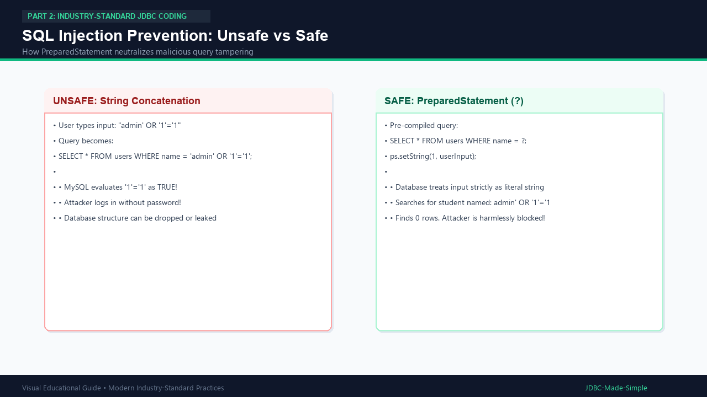

# 16. SQL Injection Prevention

SQL Injection is one of the most critical security vulnerabilities in web and database software.

---

## 1. What is SQL Injection?

SQL Injection occurs when an application takes untrusted user input and concatenates it directly into an SQL query string.
An attacker can type SQL syntax (like quotes, comments `--`, or boolean logic `OR 1=1`) to manipulate what query the database executes!

---

## 2. Visual Explanation

### Unsafe Concatenation vs Safe PreparedStatement


---

## 3. The Unsafe Way vs The Safe Way

### The Vulnerable Way (Statement)
```java
// If user enters: "Alice' OR '1'='1"
String query = "SELECT * FROM students WHERE name = '" + userInput + "'";
// Database runs: SELECT * FROM students WHERE name = 'Alice' OR '1'='1';
// '1'='1' is always true! ALL students are exposed!
```

### The 100% Safe Way (PreparedStatement)
```java
String query = "SELECT * FROM students WHERE name = ?";
PreparedStatement ps = conn.prepareStatement(query);
ps.setString(1, userInput);
// The entire string is treated as a single literal search value.
// No extra SQL commands can ever be executed!
```
