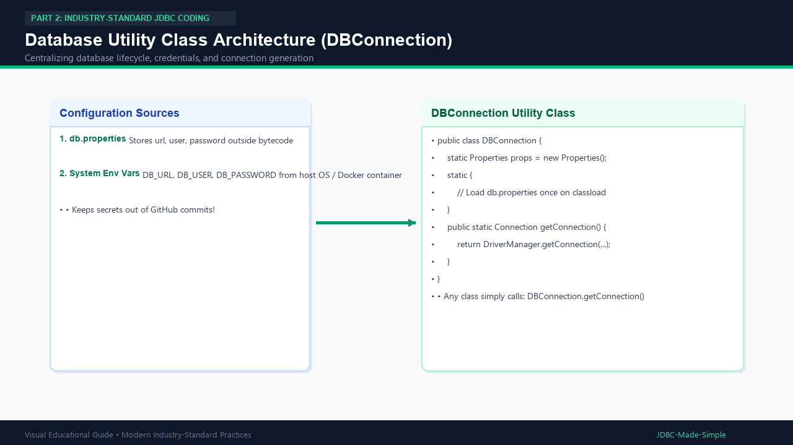

# 17. Database Utility Class

A clean, production-ready utility class centralizes connection management and configuration loading.

---

## 1. What is a Utility Class?

A utility class contains reusable `static` helper methods. In JDBC, `DBConnection` ensures your entire application shares one consistent, secure method to obtain database connections.

---

## 2. Visual Explanation

### Database Utility Architecture


---

## 3. Java Implementation: `DBConnection.java`

```java
package com.example.jdbc.util;

import java.io.InputStream;
import java.sql.Connection;
import java.sql.DriverManager;
import java.sql.SQLException;
import java.util.Properties;

public final class DBConnection {
    private static final Properties props = new Properties();

    static {
        try (InputStream in = DBConnection.class.getClassLoader().getResourceAsStream("db.properties")) {
            if (in != null) {
                props.load(in);
            }
        } catch (Exception e) {
            System.err.println("Could not load db.properties, checking environment variables...");
        }
    }

    private DBConnection() {} // Prevent instantiation

    public static Connection getConnection() throws SQLException {
        String url = System.getenv("DB_URL") != null ? System.getenv("DB_URL") :
                props.getProperty("db.url", "jdbc:mysql://localhost:3306/college_db");
        String user = System.getenv("DB_USER") != null ? System.getenv("DB_USER") :
                props.getProperty("db.user", "root");
        String pass = System.getenv("DB_PASSWORD") != null ? System.getenv("DB_PASSWORD") :
                props.getProperty("db.password", "root123");

        return DriverManager.getConnection(url, user, pass);
    }
}
```
