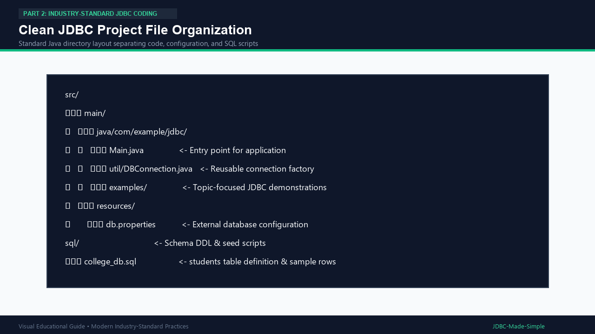

# 18. Proper JDBC Project File Organization

Keeping your project files structured makes code easy to maintain, debug, and scale.

---

## 1. Clean Learning Project Structure

```text
src/
    main/
        java/
            com/example/jdbc/
                Main.java
                util/
                    DBConnection.java
                examples/
                    StatementExample.java
                    PreparedStatementExample.java
                    CallableStatementExample.java
        resources/
            db.properties
sql/
    college_db.sql
```

---

## 2. Visual Explanation

### Folder Structure


---

## 3. Explaining Each Folder and File

1. **`src/main/java/com/example/jdbc/`**: Contains root Java package code.
2. **`Main.java`**: The main entry point demonstrating execution.
3. **`util/DBConnection.java`**: Reusable connection factory class.
4. **`examples/`**: Contains small, focused classes demonstrating specific JDBC concepts.
5. **`src/main/resources/db.properties`**: External configuration file keeping passwords out of source code.
6. **`sql/`**: Contains database schema definitions (`CREATE TABLE`) and test seed data.
