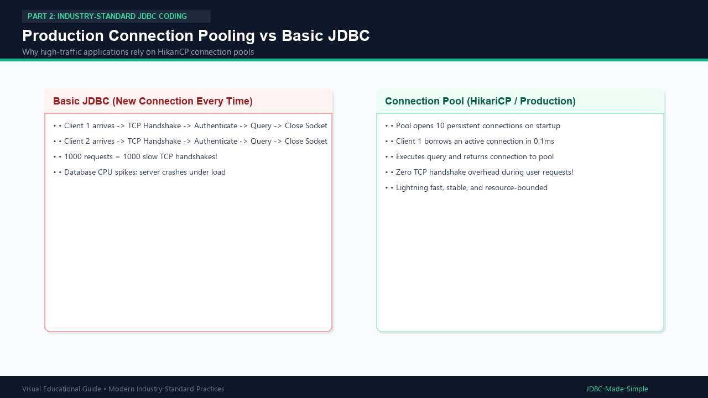

# 19. JDBC Resource and Connection Best Practices

A checklist of rules followed by top engineering teams when developing with JDBC.

---

## 1. Core Best Practice Rules

1. **Always use try-with-resources:** Guarantees proper teardown of `Connection`, `Statement`, and `ResultSet`.
2. **Never concatenate user strings into SQL:** Use `PreparedStatement` with `?` placeholders.
3. **Externalize credentials:** Never commit actual database passwords to version control.
4. **Use Connection Pooling in production:** Libraries such as **HikariCP** avoid opening and closing physical network sockets for every user request.
5. **Set explicit timeouts:** Use `setQueryTimeout()` to prevent rogue queries from freezing application threads.
6. **Use Transactions when grouping multiple updates:** Ensure either all updates succeed or all rollback.

---

## 2. Visual Explanation

### Connection Pooling Overview

