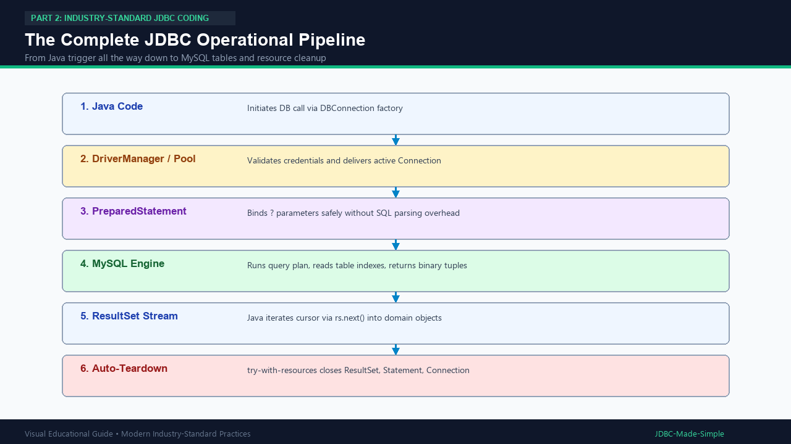

# 20. Complete JDBC Execution Flow

This topic brings together everything we have learned so far into one clear, end-to-end execution flow.

---

## 1. The Full Lifecycle Journey

```text
Java Application
       ↓
DriverManager / Connection Pool
       ↓
Connection (TCP Socket established)
       ↓
PreparedStatement (SQL pre-compiled, ? parameters bound)
       ↓
MySQL Server (Execution engine reads tables)
       ↓
ResultSet / Update Count (Data returned over socket)
       ↓
AutoCloseable Resource Teardown (Connection closed or returned to pool)
```

---

## 2. Visual Explanation

### Complete JDBC Flow


---

## 3. End-to-End Java Code: `CompleteJDBCFlowDemo.java`

```java
package com.example.jdbc.flow;

import java.sql.Connection;
import java.sql.DriverManager;
import java.sql.PreparedStatement;
import java.sql.ResultSet;
import java.sql.SQLException;

public class CompleteJDBCFlowDemo {
    public static void main(String[] args) {
        String url = "jdbc:mysql://localhost:3306/college_db";
        String user = System.getenv("DB_USER") != null ? System.getenv("DB_USER") : "root";
        String pass = System.getenv("DB_PASSWORD") != null ? System.getenv("DB_PASSWORD") : "root123";

        String query = "SELECT id, name, age, department FROM students WHERE age >= ?";

        try (Connection conn = DriverManager.getConnection(url, user, pass);
             PreparedStatement ps = conn.prepareStatement(query)) {

            ps.setInt(1, 20);

            try (ResultSet rs = ps.executeQuery()) {
                System.out.println("=== Complete Flow Records ===");
                while (rs.next()) {
                    System.out.println(rs.getInt("id") + " - " + rs.getString("name") + " (" + rs.getString("department") + ")");
                }
            }
        } catch (SQLException e) {
            e.printStackTrace();
        }
    }
}
```
