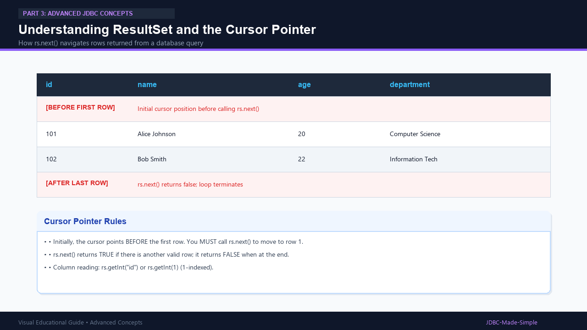
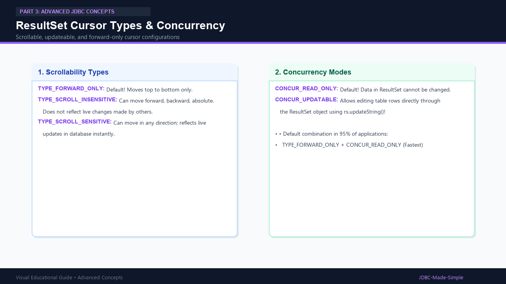

# 21 & 22. ResultSet, Types and Concurrency

When you execute a `SELECT` query, JDBC returns the data wrapped inside a `java.sql.ResultSet`.

---

## 1. What is a ResultSet?

A `ResultSet` is a tabular data structure representing database rows produced by a query.
It maintains an internal **cursor** (pointer) pointing to one row at a time.

```java
ResultSet rs = ps.executeQuery();
while (rs.next()) {
    int id = rs.getInt("id");
    String name = rs.getString("name");
}
```

---

## 2. Visual Explanation

### ResultSet Cursor Movement


### Cursor Types and Concurrency


---

## 3. ResultSet Types and Concurrency Modes

### Scrollability Types
1. **`TYPE_FORWARD_ONLY` (Default):** Cursor can only step forward from top to bottom.
2. **`TYPE_SCROLL_INSENSITIVE`:** Cursor can move forward, backward, or jump to an absolute position (`rs.previous()`, `rs.absolute(5)`). It does not reflect modifications made to the database while open.
3. **`TYPE_SCROLL_SENSITIVE`:** Can navigate in any direction and reflects live updates in the underlying database.

### Concurrency Modes
1. **`CONCUR_READ_ONLY` (Default):** Data cannot be modified through the `ResultSet`.
2. **`CONCUR_UPDATABLE`:** Allows updating table rows directly via Java methods like `rs.updateString("department", "CSE")` followed by `rs.updateRow()`.

---

## 4. Java Code: `ResultSetDemo.java`

```java
package com.example.jdbc.resultset;

import java.sql.Connection;
import java.sql.DriverManager;
import java.sql.PreparedStatement;
import java.sql.ResultSet;
import java.sql.SQLException;

public class ResultSetDemo {
    public static void main(String[] args) {
        String url = "jdbc:mysql://localhost:3306/college_db";
        String user = System.getenv("DB_USER") != null ? System.getenv("DB_USER") : "root";
        String pass = System.getenv("DB_PASSWORD") != null ? System.getenv("DB_PASSWORD") : "root123";

        String sql = "SELECT id, name, age, department FROM students";

        try (Connection conn = DriverManager.getConnection(url, user, pass);
             PreparedStatement ps = conn.prepareStatement(sql);
             ResultSet rs = ps.executeQuery()) {

            System.out.println("=== Iterating ResultSet Rows ===");
            while (rs.next()) {
                // Reading by column name
                int id = rs.getInt("id");
                String name = rs.getString("name");
                int age = rs.getInt("age");
                String dept = rs.getString("department");

                System.out.printf("Student #%d: %s (Age: %d, Dept: %s)%n", id, name, age, dept);
            }
        } catch (SQLException e) {
            e.printStackTrace();
        }
    }
}
```
