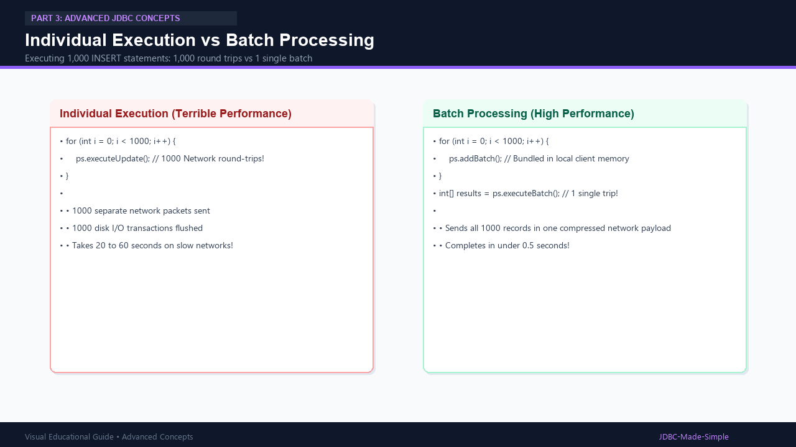
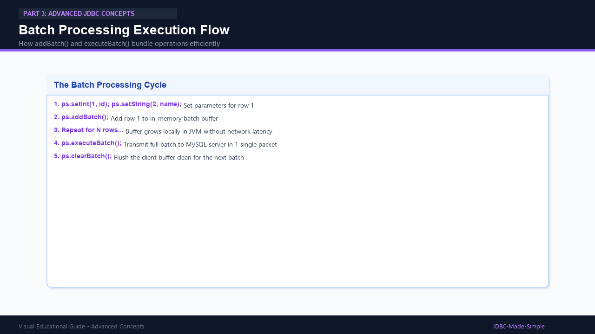

# 23. Batch Processing

Batch processing allows bundling multiple SQL operations together and sending them to the database in one single network trip.

---

## 1. Why Batch Processing?

Executing 1,000 separate `INSERT` statements creates 1,000 individual TCP network round trips and 1,000 transaction log commits.
With batch processing:
1. Java accumulates operations in a local client buffer using `addBatch()`.
2. Java sends all operations in a single consolidated packet using `executeBatch()`.
3. Execution time drops from 30+ seconds down to less than 1 second!

---

## 2. Visual Explanation

### Individual vs Batch Processing


### Batch Processing Flow


---

## 3. Java Code: `BatchProcessingDemo.java`

```java
package com.example.jdbc.batch;

import java.sql.Connection;
import java.sql.DriverManager;
import java.sql.PreparedStatement;
import java.sql.SQLException;

public class BatchProcessingDemo {
    public static void main(String[] args) {
        String url = "jdbc:mysql://localhost:3306/college_db";
        String user = System.getenv("DB_USER") != null ? System.getenv("DB_USER") : "root";
        String pass = System.getenv("DB_PASSWORD") != null ? System.getenv("DB_PASSWORD") : "root123";

        String sql = "INSERT INTO students (id, name, age, department) VALUES (?, ?, ?, ?) ON DUPLICATE KEY UPDATE name=name";

        try (Connection conn = DriverManager.getConnection(url, user, pass);
             PreparedStatement ps = conn.prepareStatement(sql)) {

            // Turn off autocommit for fastest batch performance
            conn.setAutoCommit(false);

            // Record 1
            ps.setInt(1, 105);
            ps.setString(2, "Edward Norton");
            ps.setInt(3, 23);
            ps.setString(4, "Civil Eng");
            ps.addBatch();

            // Record 2
            ps.setInt(1, 106);
            ps.setString(2, "Fiona Gallagher");
            ps.setInt(3, 21);
            ps.setString(4, "Biotech");
            ps.addBatch();

            // Execute all batched statements in one round-trip
            int[] results = ps.executeBatch();
            conn.commit(); // Commit all together

            System.out.println("Batch completed successfully! Batched records executed: " + results.length);

        } catch (SQLException e) {
            e.printStackTrace();
        }
    }
}
```
