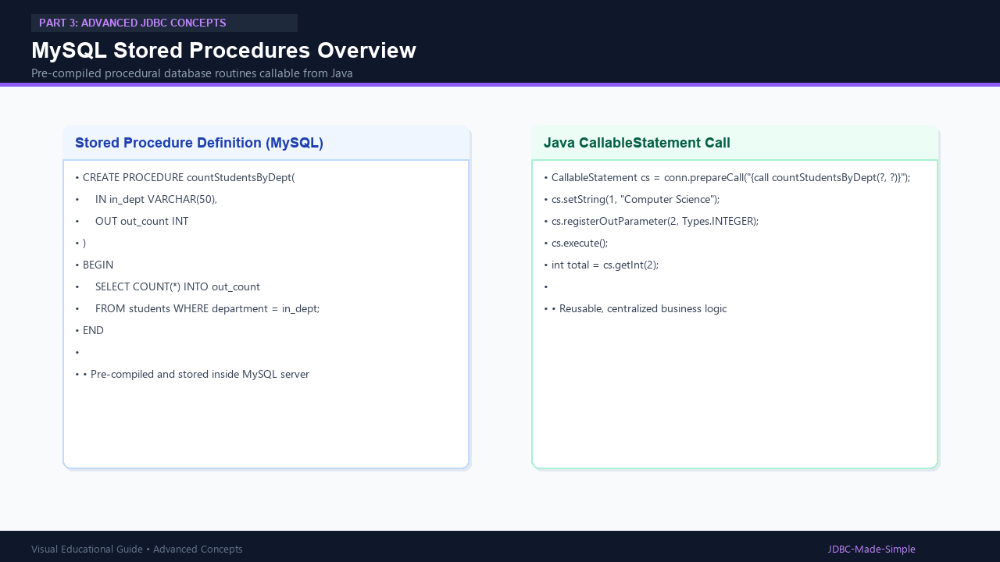
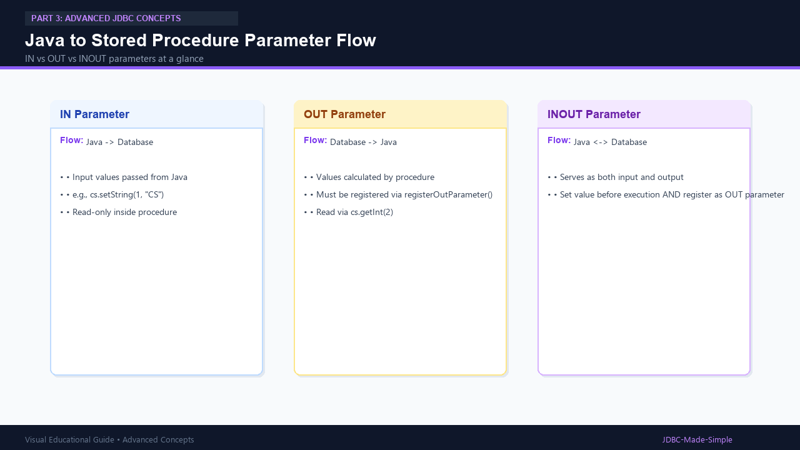

# 24. Stored Procedures in Depth

Deep dive into creating MySQL Stored Procedures and calling them from Java using `CallableStatement`.

---

## 1. What is a Stored Procedure?

A stored procedure is a pre-compiled subroutine saved directly in the MySQL database engine.
It encapsulates SQL logic, reduces network latency, and enables fine-grained permission control.

---

## 2. Visual Explanation

### Stored Procedure Execution


### Parameter Passing Architecture


---

## 3. MySQL Procedure SQL Script

```sql
USE college_db;

DELIMITER //

CREATE PROCEDURE getStudentCountByDept(
    IN in_dept VARCHAR(50),
    OUT out_count INT
)
BEGIN
    SELECT COUNT(*) INTO out_count
    FROM students
    WHERE department = in_dept;
END //

DELIMITER ;
```

---

## 4. Java Code: `StoredProcedureDemo.java`

```java
package com.example.jdbc.procedures;

import java.sql.CallableStatement;
import java.sql.Connection;
import java.sql.DriverManager;
import java.sql.SQLException;
import java.sql.Types;

public class StoredProcedureDemo {
    public static void main(String[] args) {
        String url = "jdbc:mysql://localhost:3306/college_db";
        String user = System.getenv("DB_USER") != null ? System.getenv("DB_USER") : "root";
        String pass = System.getenv("DB_PASSWORD") != null ? System.getenv("DB_PASSWORD") : "root123";

        String callSql = "{call getStudentCountByDept(?, ?)}";

        try (Connection conn = DriverManager.getConnection(url, user, pass);
             CallableStatement cs = conn.prepareCall(callSql)) {

            // Set IN parameter
            cs.setString(1, "Computer Science");

            // Register OUT parameter
            cs.registerOutParameter(2, Types.INTEGER);

            // Execute
            cs.execute();

            // Read output
            int count = cs.getInt(2);
            System.out.println("Total students in Computer Science: " + count);

        } catch (SQLException e) {
            e.printStackTrace();
        }
    }
}
```
