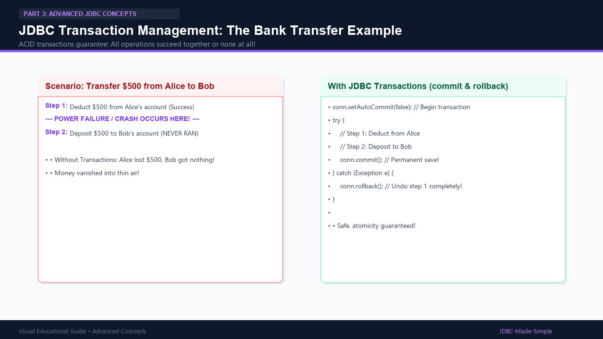
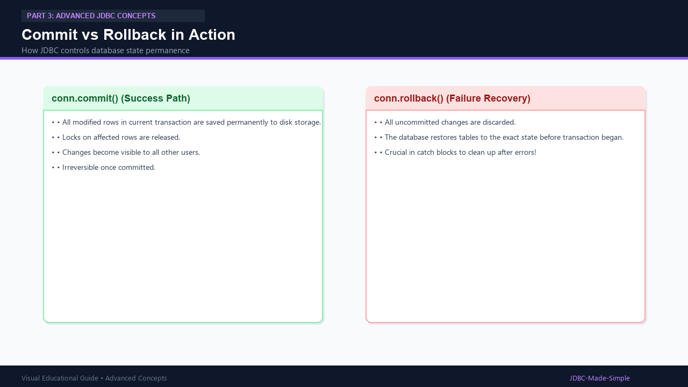

# 25. JDBC Transactions

Transactions ensure data integrity by enforcing **ACID** properties (Atomicity, Consistency, Isolation, Durability).

---

## 1. What is a Transaction?

A transaction treats multiple SQL statements as a single, atomic unit of work:
> **Either every single statement succeeds and is saved permanently (`commit()`), or if any failure occurs, all previous statements are completely undone (`rollback()`).**

---

## 2. Visual Explanation

### Transaction Flow

### Commit vs Rollback

---

## 3. Controlling Transactions in JDBC

By default, JDBC operates in **auto-commit mode** (`conn.getAutoCommit() == true`), meaning every individual statement commits immediately.

To create a transaction:
1. `conn.setAutoCommit(false);` // Starts manual transaction boundary
2. Execute SQL operations
3. `conn.commit();` // Permanent save
4. Inside catch block: `conn.rollback();` // Undo everything on error!
