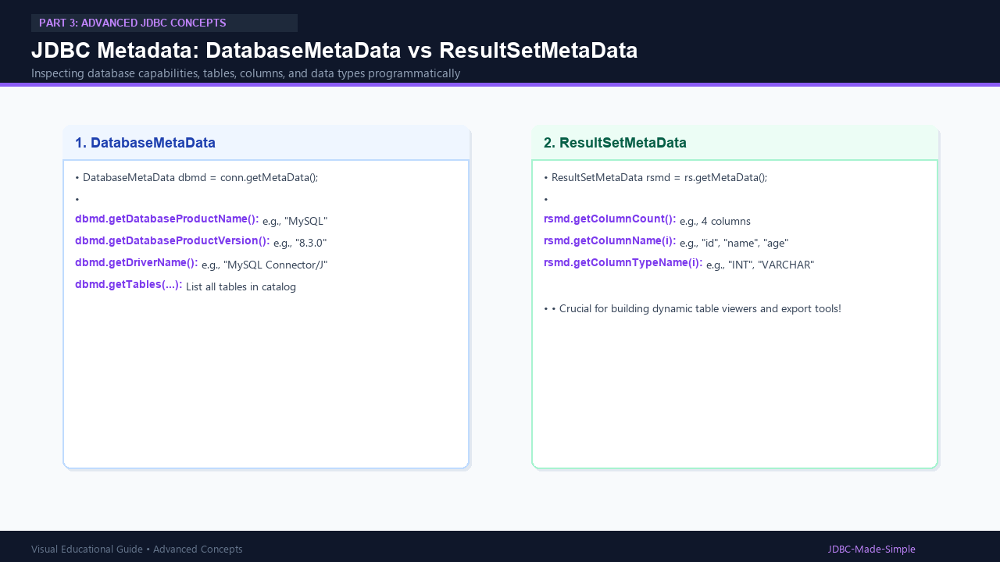

# 26. JDBC Metadata

Metadata is "data about data". JDBC allows you to inspect database capabilities and table schemas dynamically at runtime.

---

## 1. The Two Main Metadata Interfaces

1. **`DatabaseMetaData`:** Information about the database server itself (vendor name, version, supported SQL features, table catalog).
2. **`ResultSetMetaData`:** Information about columns returned by a query (column names, counts, SQL data types).

---

## 2. Visual Explanation

### JDBC Metadata Architecture


---

## 3. Java Code: `MetadataDemo.java`

```java
package com.example.jdbc.metadata;

import java.sql.Connection;
import java.sql.DatabaseMetaData;
import java.sql.DriverManager;
import java.sql.PreparedStatement;
import java.sql.ResultSet;
import java.sql.ResultSetMetaData;
import java.sql.SQLException;

public class MetadataDemo {
    public static void main(String[] args) {
        String url = "jdbc:mysql://localhost:3306/college_db";
        String user = System.getenv("DB_USER") != null ? System.getenv("DB_USER") : "root";
        String pass = System.getenv("DB_PASSWORD") != null ? System.getenv("DB_PASSWORD") : "root123";

        try (Connection conn = DriverManager.getConnection(url, user, pass)) {

            // 1. Inspect DatabaseMetaData
            DatabaseMetaData dbmd = conn.getMetaData();
            System.out.println("=== Database Metadata ===");
            System.out.println("Database Product: " + dbmd.getDatabaseProductName());
            System.out.println("Product Version:  " + dbmd.getDatabaseProductVersion());
            System.out.println("Driver Name:      " + dbmd.getDriverName());

            // 2. Inspect ResultSetMetaData
            String query = "SELECT * FROM students LIMIT 1";
            try (PreparedStatement ps = conn.prepareStatement(query);
                 ResultSet rs = ps.executeQuery()) {

                ResultSetMetaData rsmd = rs.getMetaData();
                int columnCount = rsmd.getColumnCount();

                System.out.println("\n=== ResultSet Metadata (students table) ===");
                System.out.println("Total Columns: " + columnCount);

                for (int i = 1; i <= columnCount; i++) {
                    System.out.printf("Column %d: %-15s | Type: %s%n",
                            i, rsmd.getColumnName(i), rsmd.getColumnTypeName(i));
                }
            }

        } catch (SQLException e) {
            e.printStackTrace();
        }
    }
}
```
