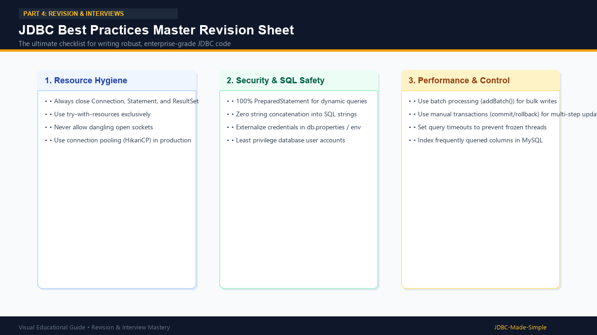

# 27. JDBC Best Practices Master Revision

A comprehensive review of the essential rules for writing clean, secure, and production-ready JDBC code.

---

## 1. Visual Summary

### Best Practices Infographic

---

## 2. Core Best Practice Rules

### Rule 1: Always Use try-with-resources
Never manually close resources in nested `finally` blocks. `try-with-resources` ensures resources close in the proper reverse order (`ResultSet` -> `Statement` -> `Connection`) even when unforeseen runtime exceptions arise.

### Rule 2: 100% PreparedStatement Usage for Parameterized Queries
Never concatenate variables into raw SQL strings using `+`. Always use `PreparedStatement` with `?` placeholders to guarantee immunity against SQL Injection attacks.

### Rule 3: Never Expose Credentials in Source Code
Do not hardcode database passwords in Java files. Read configuration from external `db.properties` files or environment variables (`System.getenv()`).

### Rule 4: Use Connection Pools in Production
Directly creating connections via `DriverManager.getConnection()` for every web request causes high latency and crashes database servers. Use production connection pools like **HikariCP** to reuse pre-warmed connections.

### Rule 5: Manage Transactions for Multi-Step Operations
Whenever performing multiple dependent database operations (such as debiting and crediting accounts), disable auto-commit (`conn.setAutoCommit(false)`), commit on success (`conn.commit()`), and always rollback in the `catch` block (`conn.rollback()`).

### Rule 6: Use Batch Processing for Bulk Inserts
Use `ps.addBatch()` and `ps.executeBatch()` instead of calling `ps.executeUpdate()` inside a tight loop. This reduces 1,000 network round trips down to a single network call.
