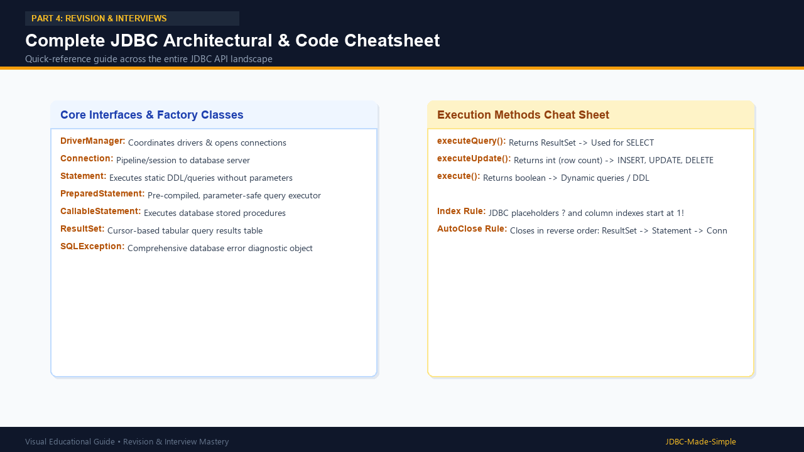

# 28. JDBC Quick Revision

Your complete high-yield revision sheet covering all core JDBC components, classes, interfaces, and methods.

---

## 1. Visual Summary

### Complete Quick Revision Infographic

---

## 2. Essential Classes & Interfaces at a Glance

| Component | Type | Primary Purpose |
| :--- | :--- | :--- |
| **`DriverManager`** | Class | Factory that registers drivers and establishes database connections. |
| **`Connection`** | Interface | Active TCP communication channel to the database. Manages transactions. |
| **`Statement`** | Interface | Executes static, non-parameterized SQL statements. |
| **`PreparedStatement`** | Interface | Pre-compiled, parameterized SQL executor immune to SQL injection. |
| **`CallableStatement`** | Interface | Executes stored procedures with IN, OUT, and INOUT parameters. |
| **`ResultSet`** | Interface | Tabular result returned by SELECT queries with an internal movable cursor. |
| **`SQLException`** | Class | Checked exception wrapping database errors, error codes, and SQL states. |

---

## 3. Four Basic Steps Summary

1. **Register Driver:** Automatic in modern JDBC via Service Provider Interface (SPI).
2. **Open Connection:** `DriverManager.getConnection(url, user, password)`.
3. **Execute SQL:** `PreparedStatement.executeQuery()` (for SELECT) or `executeUpdate()` (for DML).
4. **Close Resources:** Automatically handled via `try-with-resources`.
