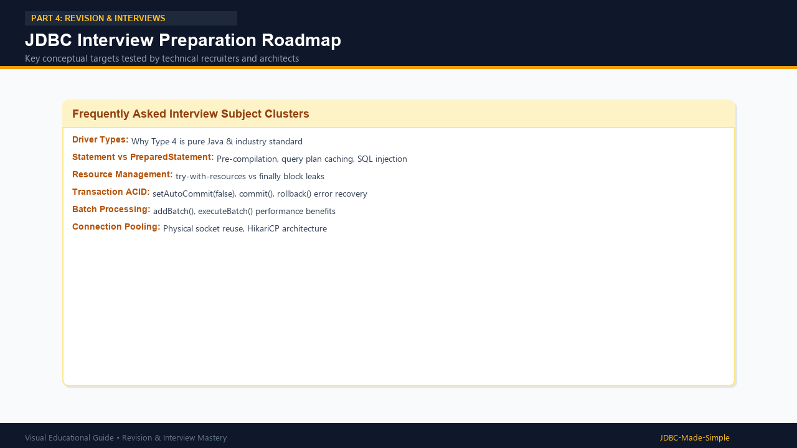

# 29. JDBC Interview Questions & Answers

A curated set of 25 essential interview questions with simple, accurate, industry-standard answers.

---

## Visual Roadmap

---

## Beginner Questions

### Q1: What is JDBC?
**Answer:** JDBC (Java Database Connectivity) is a standard Java API (`java.sql`) that allows Java applications to communicate with relational databases like MySQL, Oracle, and PostgreSQL.

### Q2: What are the main components of JDBC?
**Answer:**
1. **JDBC API:** Standard Java interfaces (`Connection`, `Statement`, `PreparedStatement`, `ResultSet`).
2. **DriverManager:** The coordinator that loads drivers and creates connections.
3. **JDBC Driver:** Vendor-specific JAR implementing the JDBC interfaces.
4. **Database Server:** The RDBMS holding tables and data.

### Q3: Why is `Class.forName("com.mysql.cj.jdbc.Driver")` unnecessary in modern JDBC?
**Answer:** Starting from JDBC 4.0 (Java 6+), the JVM uses the **Service Provider Interface (SPI)** mechanism. Drivers include a configuration file inside `META-INF/services/java.sql.Driver`. When `DriverManager.getConnection()` is called, Java automatically finds and registers the driver.

### Q4: What is the difference between `Statement` and `PreparedStatement`?
**Answer:**
- `Statement` compiles SQL on every execution, cannot use `?` placeholders, and is vulnerable to SQL injection if concatenating strings.
- `PreparedStatement` pre-compiles SQL once, caches the execution plan, binds parameters with `?`, and is completely immune to SQL injection.

### Q5: What does `ResultSet.next()` do?
**Answer:** It moves the cursor to the next row of data. It returns `true` if another row is available, or `false` when there are no more rows. Initially, the cursor points before the first row, so `rs.next()` must be called before reading any data.

---

## Intermediate Questions

### Q6: What is SQL Injection and how does PreparedStatement prevent it?
**Answer:** SQL Injection is a vulnerability where malicious SQL commands are injected into user inputs (e.g. `' OR '1'='1`). `PreparedStatement` prevents this because the SQL syntax is pre-compiled before input is added. Any input bound through `setString()` is treated strictly as literal data, never as executable SQL commands.

### Q7: What is the difference between `executeQuery()`, `executeUpdate()`, and `execute()`?
**Answer:**
- `executeQuery()`: Used for `SELECT` queries only. Returns a `ResultSet`.
- `executeUpdate()`: Used for `INSERT`, `UPDATE`, `DELETE`, and DDL statements. Returns an `int` representing affected rows.
- `execute()`: Used for any SQL query or procedure returning multiple results. Returns a `boolean` (`true` if result is a ResultSet, `false` if row count).

### Q8: Why is try-with-resources preferred over try-catch-finally in JDBC?
**Answer:**
- `try-with-resources` guarantees automatic closing in exact reverse order of creation.
- It prevents memory and socket leaks even when unhandled exceptions occur.
- It attaches closing exceptions as **suppressed exceptions**, preserving the original root cause error.

### Q9: What is the significance of `setAutoCommit(false)`?
**Answer:** By default, JDBC operates in auto-commit mode (every query is committed immediately). Calling `conn.setAutoCommit(false)` starts a manual transaction, allowing you to run multiple SQL operations and then execute `conn.commit()` together, or `conn.rollback()` if an error occurs.

### Q10: How do you call a stored procedure in JDBC?
**Answer:** Use `CallableStatement cs = conn.prepareCall("{call procedureName(?, ?)}");`. Set inputs using `cs.setXxx()` and register outputs using `cs.registerOutParameter(index, Types.XXX)`.

---

## Advanced Questions

### Q11: What is Connection Pooling and why is it used?
**Answer:** Creating a new physical database connection requires an expensive TCP handshake and authentication. A Connection Pool (e.g., HikariCP) creates a pool of pre-warmed connections on startup. Threads borrow an existing connection in sub-milliseconds and return it to the pool when finished, boosting application throughput and stability.

### Q12: What is the difference between `TYPE_SCROLL_INSENSITIVE` and `TYPE_SCROLL_SENSITIVE`?
**Answer:** Both allow navigating forward and backward. `TYPE_SCROLL_INSENSITIVE` does not reflect updates made by other concurrent users while open; `TYPE_SCROLL_SENSITIVE` reflects live updates made to the database rows in real time.

### Q13: How does batch processing improve performance?
**Answer:** Batch processing accumulates multiple statements using `addBatch()` and transmits them to the database in a single network round-trip using `executeBatch()`, eliminating repeated network latency.

### Q14: What is `DatabaseMetaData` vs `ResultSetMetaData`?
**Answer:**
- `DatabaseMetaData`: Provides system information about the database server (version, vendor name, table listings).
- `ResultSetMetaData`: Provides information about query results (column count, column names, column data types).

### Q15: What happens if you forget to close a JDBC Connection?
**Answer:** The underlying network socket remains open on the database server. If connections continue to leak, the MySQL server exhausts its connection thread pool and throws: `SQLException: Too many connections`, preventing any user from connecting.
